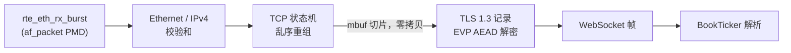

# nsst：基于 DPDK 的用户态 TCP/IP 协议栈

实现 ARP、IPv4、ICMP、UDP、TCP，上层接 TLS 1.3 + WebSocket，订阅 Binance BookTicker 行情。

## 数据路径



## 延迟和优化

- **缓存优化** 降低TCP定时器等的推进频率，减少空转时对缓存的挤占。端口空闲时，每个维护节拍用一帧预制 TCP 帧预热缓存。
- **自定义TLS** 避开使用BIO的拷贝开销

订阅 Binance BTCUSDT bookTicker 实盘行情。单位 µs：

| 阶段 | 版本 | P50 | P90 | P99 | P99.9 |
|---|---|---|---|---|---|
| 包进入协议栈到 TCP 交付 | 优化前 | 1.30 | 3.02 | 3.88 | 9.6 |
| | 优化后 | 0.66 | 1.79 | 2.51 | 7.8 |
| TLS 取得一段明文 | 优化前 | 5.93 | 13.07 | 17.44 | 28.5 |
| | 优化后 | 1.07 | 1.97 | 3.23 | 9.6 |
| JSON 解析一条行情 | 优化前 | 0.56 | 3.04 | 4.20 | 9.1 |
| | 优化后 | 0.33 | 0.52 | 0.74 | 1.3 |


优化后，单条行情从所在数据包进入协议栈到 JSON 解析完成：P50 4.3、P90 8.4、P99 16.6、P99.9 38.0 µs。

### 预热实验

| 阶段 | 不预热 P50 / P99 | 空闲预热 P50 / P99 |
|---|---|---|
| 包进入协议栈到 TCP 交付 | 0.75 / 3.14 | 0.55 / 2.35 |
| TLS 取得一段明文 | 3.19 / 12.54 | 0.94 / 2.81 |
| JSON 解析一条行情 | 0.41 / 1.56 | 0.31 / 0.70 |
| 单条行情收包到解析完成 | 6.02 / 20.93 | 3.66 / 14.38 |

## 实现内容

- **ARP**：请求与应答，LRU 缓存。
- **IPv4 / ICMP**：ICMP echo。
- **TCP**：建立连接、乱序重组
- **TLS 1.3**：握手
- **WebSocket**：升级握手建立连接


## 运行

依赖：DPDK（含 net_af_packet）、OpenSSL 3、CMake 3.20+、C++20 编译器、Python 3。

```bash
cmake -S . -B build && cmake --build build --parallel
ctest --test-dir build        
scripts/demo.sh               # 本地回放
scripts/demo_live.sh          # 订阅 Binance 实盘行情
```

